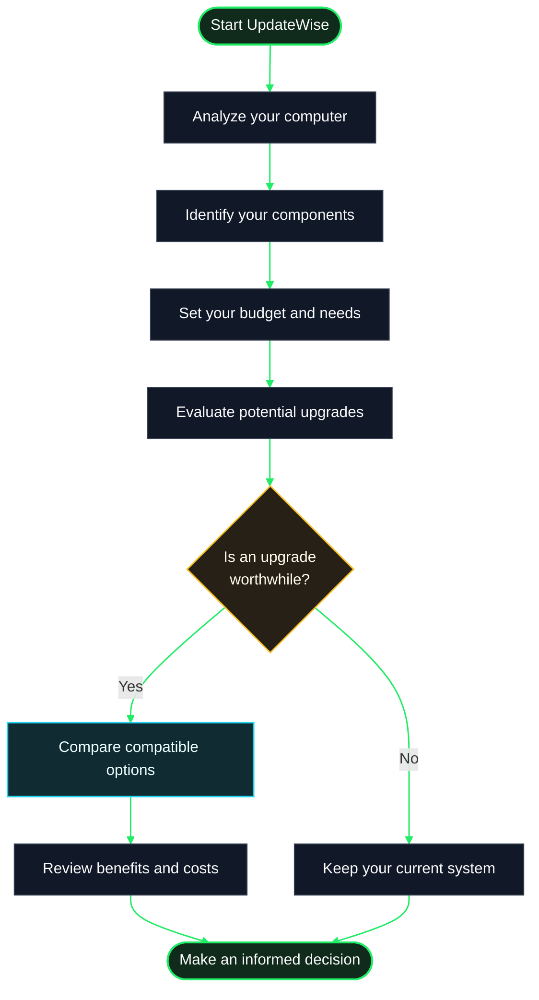

# How Does UpdateWise Work?

UpdateWise helps you understand your computer and evaluate whether upgrading any of its components is worthwhile. The goal is to help you make an informed decision based on what you do, how much you want to spend, and which options make sense for your system.

You don't need to be a hardware expert. UpdateWise organizes the information and gives you clearer guidance for comparing alternatives.

## 1. We Analyze Your Computer

UpdateWise collects information about the components it can detect, such as your processor, graphics card, RAM, and storage. This creates a snapshot of your computer's current configuration.

This information serves as a starting point for understanding what you have installed and which specifications matter when considering an upgrade.

## 2. Tell Us What You Need

Not every computer is evaluated in the same way. How you use it matters: studying, working, programming, gaming, or creative tasks can all affect which component is worth upgrading.

Your budget and region also matter. This helps focus recommendations on alternatives that suit your needs and the options available in your market.

## 3. We Evaluate Your Options

Using your system information and needs as a reference, UpdateWise helps you compare potential upgrades. The evaluation considers the system as a whole rather than relying on a single number or a brand's popularity.

A more powerful component isn't always the best purchase. It might cost too much, provide only a small improvement for your tasks, or be incompatible with the rest of your system. That's why checking compatibility and expected benefits before making a decision is important.

## 4. Weigh the Benefits Against Your Budget

The goal is to help you understand which option makes the most sense for you. A worthwhile upgrade should address a real need and, whenever possible, fit within the amount you plan to spend.

The results are intended to support your decision, not guarantee specific performance. Actual performance also depends on factors such as the applications you use, system configuration, cooling, drivers, and component condition.

## 5. You Make the Decision

Review the comparison, check the specifications, and confirm the physical and electrical compatibility of any component before buying it. If an upgrade requires opening your computer or handling internal components, follow the manufacturer's instructions or seek help from someone with experience.

UpdateWise is designed to give you a clearer picture of your options. The final decision is always yours.

## The Process at a Glance

The following diagram summarizes the general journey, from detecting your system to deciding whether to upgrade.

## What Should You Keep in Mind?

- **Compatibility is essential.** Before buying, check that the component is compatible with your motherboard, power supply, case, and other relevant hardware.
- **Prices and availability can change.** Verify seller information and purchase conditions before paying.
- **Results are estimates.** An estimate does not replace testing on your own computer or guarantee the same outcome in every application.
- **You don't always need an upgrade.** If your computer already meets your needs, keeping it may be the best decision.
- **Your needs come first.** The best upgrade isn't necessarily the most expensive one; it's the one that solves a specific problem without unnecessary spending.

**In short:** UpdateWise helps you understand your computer, compare options, and make a more informed decision about potential upgrades. Less guesswork, more information to help you choose.