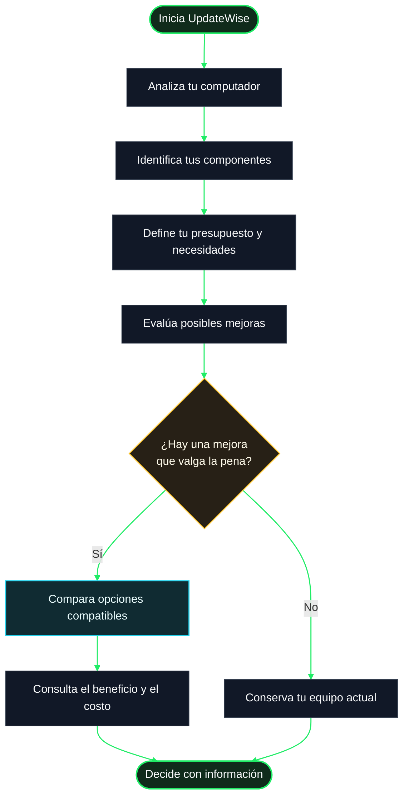

# ¿Cómo funciona UpdateWise?

UpdateWise te ayuda a entender tu computador y a evaluar si vale la pena actualizar alguno de sus componentes. La idea es que puedas tomar una decisión informada según lo que haces, cuánto quieres gastar y qué opciones tienen sentido para tu equipo.

No necesitas ser experto en hardware: UpdateWise organiza la información y te presenta una orientación más clara para comparar alternativas.

## 1. Analizamos tu computador

UpdateWise recopila información sobre los componentes que puede detectar, como el procesador, la tarjeta gráfica, la memoria RAM y el almacenamiento. Así construye una fotografía del estado de tu equipo en ese momento.

Esta información sirve como punto de partida para saber qué tienes instalado y qué características conviene tener en cuenta antes de pensar en una mejora.

## 2. Nos cuentas qué necesitas

Un computador no se evalúa igual para todas las personas. Por eso, el uso que le das importa: estudiar, trabajar, programar, jugar o realizar tareas creativas puede cambiar qué componente conviene mejorar.

También puedes tener en cuenta tu presupuesto y tu región. De esta forma, las recomendaciones pueden centrarse en alternativas que tengan sentido para tus necesidades y para las opciones disponibles en tu mercado.

## 3. Evaluamos las opciones

Con la información del equipo y tus necesidades como referencia, UpdateWise ayuda a comparar posibles mejoras. La evaluación busca considerar el conjunto del sistema y no únicamente un número aislado o la popularidad de una marca.

Una pieza más potente no siempre es la mejor compra: puede costar demasiado, aportar una mejora pequeña en tus tareas o no encajar bien con el resto del equipo. Por eso es importante revisar la compatibilidad y el beneficio esperado antes de decidir.

## 4. Comparamos el beneficio con el presupuesto

El objetivo es que puedas entender qué alternativa ofrece más sentido para ti. Una actualización recomendable debería responder a una necesidad real y ajustarse, en lo posible, al dinero que planeas invertir.

Los resultados son una ayuda para decidir, no una garantía absoluta de rendimiento. El desempeño real también depende de factores como los programas que utilizas, la configuración del sistema, la refrigeración, los controladores y el estado de los componentes.

## 5. Tú tomas la decisión

Revisa la comparación, consulta las especificaciones y confirma la compatibilidad física y eléctrica de cualquier componente antes de comprarlo. Si una actualización requiere abrir el equipo o manipular piezas, sigue las indicaciones del fabricante o pide ayuda a alguien con experiencia.

UpdateWise está pensado para darte más claridad sobre las opciones disponibles. La decisión final siempre es tuya.

## El proceso, en pocas palabras

El siguiente diagrama resume el recorrido general desde la detección del equipo hasta la decisión de actualización.

## ¿Qué debes tener presente?

- **La compatibilidad es fundamental.** Antes de comprar, comprueba que el componente sea compatible con tu placa base, fuente de alimentación, gabinete y demás piezas relevantes.
- **El precio y la disponibilidad pueden cambiar.** Verifica los datos del vendedor y las condiciones de compra antes de pagar.
- **Los resultados son orientativos.** Una estimación no sustituye las pruebas en tu propio equipo ni garantiza el mismo resultado en todos los programas.
- **No siempre necesitas actualizar.** Si tu computador ya cumple con tus tareas, conservarlo puede ser la mejor decisión.
- **Tus necesidades mandan.** La mejor mejora no es necesariamente la más cara, sino la que resuelve un problema concreto sin gastar de más.

**En resumen:** UpdateWise te ayuda a conocer tu equipo, comparar opciones y entender mejor qué actualización podría convenirte. Menos decisiones a ciegas; más información para elegir.
