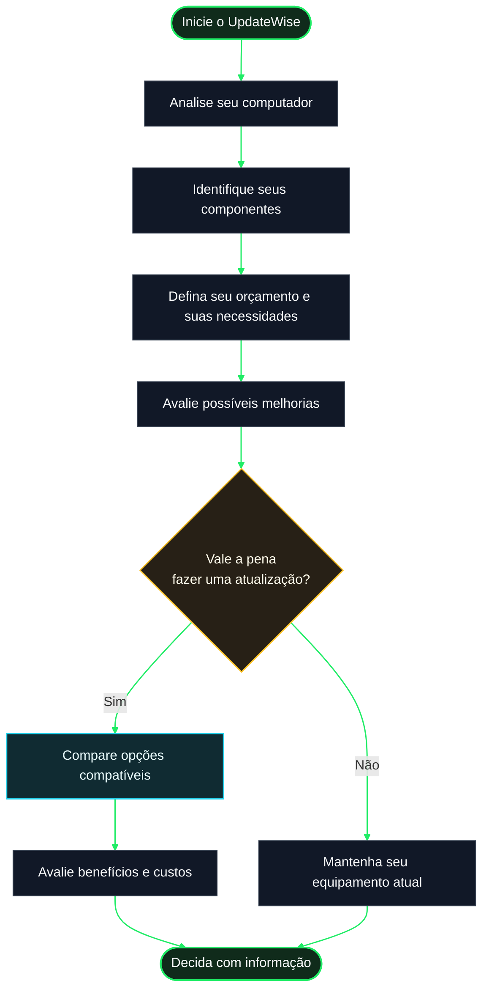

# Como o UpdateWise funciona?

O UpdateWise ajuda você a entender seu computador e avaliar se vale a pena atualizar algum de seus componentes. A ideia é permitir que você tome uma decisão informada com base no que faz, em quanto pretende gastar e nas opções que fazem sentido para o seu equipamento.

Você não precisa ser especialista em hardware: o UpdateWise organiza as informações e oferece uma orientação mais clara para comparar alternativas.

## 1. Analisamos seu computador

O UpdateWise coleta informações sobre os componentes que consegue detectar, como processador, placa de vídeo, memória RAM e armazenamento. Assim, cria um registro da configuração do seu equipamento naquele momento.

Essas informações servem como ponto de partida para entender o que está instalado e quais características devem ser consideradas antes de pensar em uma atualização.

## 2. Conte-nos o que você precisa

Um computador não deve ser avaliado da mesma forma para todas as pessoas. O uso que você faz dele importa: estudar, trabalhar, programar, jogar ou realizar tarefas criativas pode mudar qual componente vale a pena atualizar.

Seu orçamento e sua região também são importantes. Dessa forma, as recomendações podem se concentrar em alternativas adequadas às suas necessidades e às opções disponíveis no seu mercado.

## 3. Avaliamos as opções

Com as informações do equipamento e suas necessidades como referência, o UpdateWise ajuda a comparar possíveis atualizações. A avaliação busca considerar o sistema como um todo, em vez de se basear apenas em um número isolado ou na popularidade de uma marca.

Um componente mais potente nem sempre é a melhor compra: ele pode custar caro demais, trazer uma melhoria pequena para suas tarefas ou não ser compatível com o restante do equipamento. Por isso, é importante verificar a compatibilidade e o benefício esperado antes de decidir.

## 4. Comparamos os benefícios com seu orçamento

O objetivo é ajudar você a entender qual alternativa faz mais sentido. Uma atualização recomendável deve atender a uma necessidade real e, sempre que possível, respeitar o valor que você pretende investir.

Os resultados servem como apoio à decisão, não como garantia absoluta de desempenho. O desempenho real também depende de fatores como os programas utilizados, a configuração do sistema, a refrigeração, os drivers e o estado dos componentes.

## 5. Você toma a decisão

Analise a comparação, consulte as especificações e confirme a compatibilidade física e elétrica de qualquer componente antes de comprá-lo. Se uma atualização exigir abrir o computador ou manusear peças internas, siga as instruções do fabricante ou peça ajuda a alguém com experiência.

O UpdateWise foi desenvolvido para oferecer mais clareza sobre as opções disponíveis. A decisão final é sempre sua.

## O processo em poucas palavras

O diagrama a seguir resume o percurso geral, desde a detecção do equipamento até a decisão de atualização.

## O que você deve ter em mente?

- **A compatibilidade é fundamental.** Antes de comprar, verifique se o componente é compatível com a placa-mãe, a fonte de alimentação, o gabinete e as demais peças relevantes.
- **Os preços e a disponibilidade podem mudar.** Verifique as informações do vendedor e as condições de compra antes de pagar.
- **Os resultados são estimativas.** Uma estimativa não substitui testes no seu próprio computador nem garante o mesmo resultado em todos os programas.
- **Você nem sempre precisa atualizar.** Se seu computador já atende às suas necessidades, mantê-lo pode ser a melhor decisão.
- **Suas necessidades vêm primeiro.** A melhor atualização não é necessariamente a mais cara, mas aquela que resolve um problema concreto sem gastos desnecessários.

**Em resumo:** o UpdateWise ajuda você a conhecer seu equipamento, comparar opções e entender melhor qual atualização pode valer a pena. Menos decisões no escuro, mais informações para escolher.