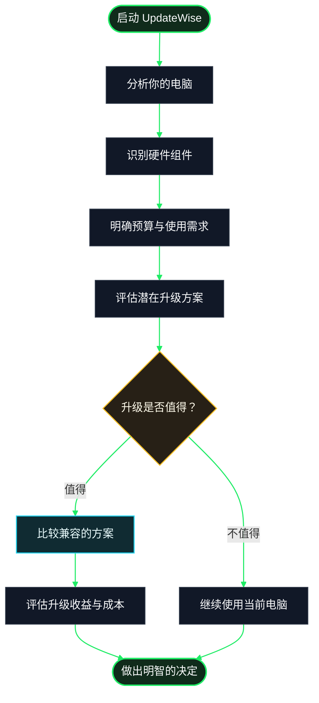

# UpdateWise 是如何工作的？

UpdateWise 帮助你了解自己的电脑，并评估升级某个硬件组件是否值得。我们的目标是让你能够根据自己的使用需求、预算以及适合当前设备的选项，做出明智的决定。

你不需要成为硬件专家。UpdateWise 会整理相关信息，帮助你更清晰地比较不同的升级方案。

## 1. 分析你的电脑

UpdateWise 会收集能够检测到的硬件信息，例如处理器、显卡、内存和存储设备，并据此记录电脑当前的硬件配置。

这些信息可以帮助你了解电脑目前的配置，以及在考虑升级之前需要关注哪些硬件参数。

## 2. 告诉我们你的需求

不同用户的电脑需求并不相同。你的使用场景很重要：学习、办公、编程、游戏或创意工作，都可能影响哪个硬件组件最值得升级。

你的预算和所在地区也同样重要。这样，推荐方案就能更贴合你的实际需求，以及当地市场上可以买到的产品。

## 3. 评估可选方案

UpdateWise 会结合你的电脑配置和使用需求，帮助你比较不同的升级方案。评估时会考虑整个系统，而不是只看某一个数字或某个品牌的知名度。

性能更强的组件不一定是最好的选择：它可能价格过高，对你的实际任务提升有限，或者无法与你电脑中的其他硬件兼容。因此，在决定购买之前，检查兼容性并评估预期收益非常重要。

## 4. 权衡升级收益与预算

我们的目标是帮助你判断哪种方案更适合自己。值得考虑的升级应该能够解决实际需求，并尽可能符合你的预算。

评估结果仅用于辅助决策，并不构成对实际性能的绝对保证。真实表现还会受到所使用的软件、系统配置、散热、驱动程序以及硬件状态等因素的影响。

## 5. 由你做出决定

请仔细查看比较结果和硬件规格，并在购买前确认组件在物理接口和电气要求方面都与你的电脑兼容。如果升级需要拆开电脑或操作内部硬件，请遵循制造商的说明，或寻求有经验的人士帮助。

UpdateWise 希望帮助你更清楚地了解各种选择。最终决定权始终在你手中。

## 整个流程一览

下面的流程图概括了从检测电脑配置到决定是否升级的整个过程。

## 你需要注意什么？

- **兼容性至关重要。** 购买之前，请确认组件与你的主板、电源、机箱以及其他相关硬件兼容。
- **价格和库存可能发生变化。** 付款前，请核实卖家信息和购买条件。
- **评估结果仅供参考。** 估算结果不能替代在你自己的电脑上进行的测试，也不能保证所有软件都能获得相同的效果。
- **并非总是需要升级。** 如果电脑已经能够满足你的需求，继续使用当前设备可能是更好的选择。
- **你的需求才是重点。** 最好的升级不一定是最贵的，而是能够解决具体问题，同时避免不必要的支出。

**总而言之：** UpdateWise 帮助你了解自己的电脑、比较不同方案，并更清楚地判断哪些升级值得考虑。减少盲目选择，用更多信息做出决定。